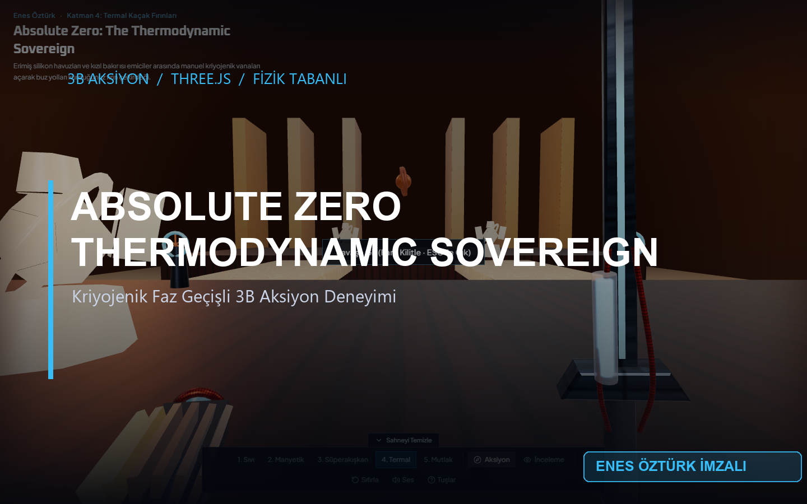
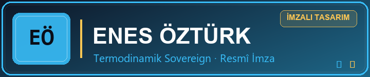
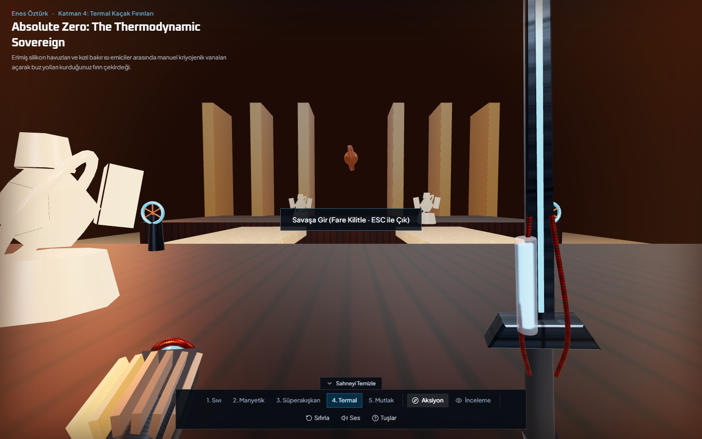
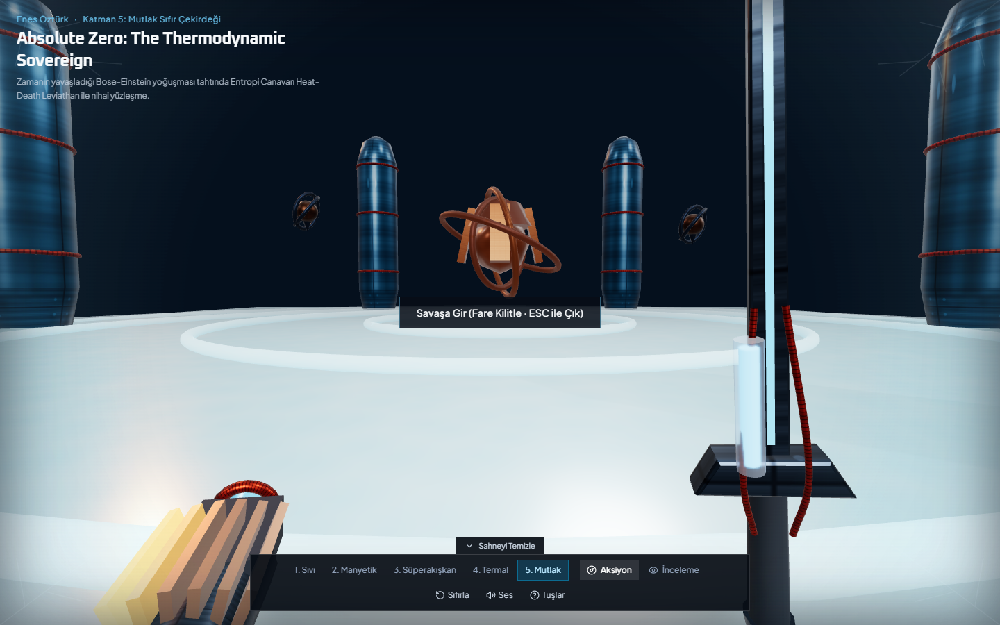

<div align="center">



# Absolute Zero: The Thermodynamic Sovereign

**Enes Öztürk imzalı, termodinamiğin yasalarını oynanabilir hale getiren 3B aksiyon deneyimi.**

[](https://github.com/EnesBinMalik/absolute-zero-thermodynamic-sovereign)
[](https://react.dev/)
[](https://www.typescriptlang.org/)
[](https://threejs.org/)
[](https://vite.dev/)

[](https://github.com/EnesBinMalik)
[](https://github.com/EnesBinMalik/absolute-zero-thermodynamic-sovereign)
[](https://github.com/EnesBinMalik/absolute-zero-thermodynamic-sovereign)
[](https://github.com/EnesBinMalik/absolute-zero-thermodynamic-sovereign)



</div>

---

## Hakkında

**Absolute Zero**, sıcaklık bir sayaç değil; bir silah, bir kalkan ve bir engel olduğu bir dünyada geçen birinci şahıs 3B aksiyon deneyimidir. Oyuncu, Kelvin Kılıcı ve Entropi Sifonu Eldiveni ile ortamın faz durumunu değiştirir; donmuş yüzeyleri kırar, süperiletken alanlarda süzülür ve ısıyı düşmanlarına geri yönlendirir.

Proje; fizik tabanlı hareket, gerçek zamanlı faz geçişleri, prosedürel arena mimarisi ve tamamen diegetik (dünya içi) bir arayüzü tek bir tarayıcı deneyiminde birleştirir. Harici bir oyun motoru kullanılmaz: tüm sahne, fizik ve kamera sistemi **Three.js** üzerinden sıfırdan kurulmuştur.

> Bu proje **Enes Öztürk** tarafından tasarlanmış, geliştirilmiş ve imzalanmıştır.

---

## Öne çıkan özellikler

| Özellik | Açıklama |
| --- | --- |
| **5 el yapımı arena** | 77 K kriyojenik şelalelerden 0,08 K Bose-Einstein tahtına kadar değişen fizik kuralları. |
| **Faz geçişi sistemi** | `kelvinToPhase()` ile 6 faz: Bose-Einstein, kırılgan kristal, katı metal, sıvı, ergimiş ve plazma. |
| **Kelvin Kılıcı** | Vakum cam tüp içindeki helyum rezervini tüketerek düşmanı anında donduran yakın dövüş silahı. |
| **Entropi Sifonu** | Düşmandan çekilen ısı, eldivenin bakır kanatlarında biriktirilip geri fırlatılabilir. |
| **Meissner akış tuzaklaması** | `Shift` ile süperiletken yüzeylerde manyetik levitasyon ve hızlı atılma. |
| **Diegetik telemetri** | Sıcaklık, bütünlük ve rezerv bilgileri HUD panelinde değil; vizör camı, kılıç tüpü ve eldiven kanatlarında gösterilir. |
| **Zaman genişlemesi** | Bose-Einstein dalgalarında `timeDilation < 1.0` ile yavaşlama etkisi. |
| **İki kamera modu** | Birinci şahıs savaş modu ve sinematik orbit/inceleme modu. |
| **Boss savaşı** | 5. arenada Entropi Canavarı *Heat-Death Leviathan* ile nihai yüzleşme. |
| **Yazılım GL yedeği** | WebGL donanım hızlandırması yoksa otomatik yazılım tabanlı görüntülemeye geçer. |

---

## Arenalar

| # | Arena | Ortam sıcaklığı | Yer çekimi | Sürtünme |
| --- | --- | --- | --- | --- |
| 01 | Sıvı Azot Çağlayanları — *The Cryo-Cascades* | 77 K | 1.00 | 0.86 |
| 02 | Manyetik Levitasyon Köprüleri — *The Maglev Chasm* | 92 K | 0.85 | 0.88 |
| 03 | Süperakışkan Helyum Labirenti — *The Superfluid Vaults* | 2.17 K | 0.92 | 0.985 |
| 04 | Termal Kaçak Fırınları — *The Thermal Runaway Core* | 640 K | 1.00 | 0.84 |
| 05 | Mutlak Sıfır Çekirdeği — *The Bose-Einstein Throne* | 0.08 K | 0.65 | 0.91 |

Her arena kendi yer çekimi, sürtünme, sis yoğunluğu ve vurgu rengiyle ayrı bir fizik deneyidir.

---

## Kontroller

| Tuş | Aksiyon |
| --- | --- |
| `W` `A` `S` `D` | Hareket |
| `Boşluk` | Zıplama |
| `Fare` / `Sürükle` | Bakış açısı |
| `Sol tık` | Kelvin Kılıcı darbesi |
| `Shift` | Meissner manyetik atılma |
| `1` – `5` | Arena seçimi |
| `ESC` | Fare kilidinden çıkış |
| `Sıfırla` | Aktif arenayı yeniden kurar |

> Savaş sırasında arayüz tamamen kaldırılır: ekranda yalnızca dünya içi telemetri kalır.

---

## Galeri





---

## Kurulum

**Gereksinimler:** Node.js 20+ ve modern bir WebGL tarayıcı.

```bash
git clone https://github.com/EnesBinMalik/absolute-zero-thermodynamic-sovereign.git
cd absolute-zero-thermodynamic-sovereign
npm install
npm run dev
```

Uygulama varsayılan olarak `http://localhost:3000` adresinde açılır.

> `.env.example` dosyası yalnızca AI Studio dağıtım şablonu içindir. Oyun tamamen istemci tarafında çalışır; yerel oynamak için API anahtarı gerekmez.

Diğer komutlar:

```bash
npm run build     # Üretim derlemesi (dist/)
npm run preview   # Derlemeyi yerelde önizle
npm run lint      # TypeScript tip kontrolü
```

---

## Teknik mimari

```text
src/
├── App.tsx                       Uygulama kabuğu, telemetri durumu, kamera modu
├── main.tsx                      React giriş noktası
├── engine/
│   └── AbsoluteZeroEngine.ts     Three.js sahnesi, fizik, düşman AI, silahlar, kamera
├── components/
│   ├── CinemaDock.tsx            Arena seçici, kontrol rehberi, ses ve sıfırlama
│   └── VisorOverlay.tsx          Diegetik vizör ve faz göstergeleri
├── types/
│   └── thermodynamics.ts         Arena, faz ve telemetri tipleri
└── styles.css                    Tailwind 4 ve özel tipler
```

Motor ve arayüz, `telemetry` durum nesnesi üzerinden tek yönlü bir köprüyle iletişim kurar. React yeniden render'ları oyun döngüsüne müdahale etmez; `requestAnimationFrame` döngüsü tamamen `AbsoluteZeroEngine` içinde yönetilir.

---

## İmza

<div align="center">

[](https://github.com/EnesBinMalik)
[](https://github.com/EnesBinMalik)

**Bu kod, tasarım ve deneyim Enes Öztürk'ün kişisel imzasını taşır.**

© 2026 Enes Öztürk — Tüm hakları saklıdır.

</div>
